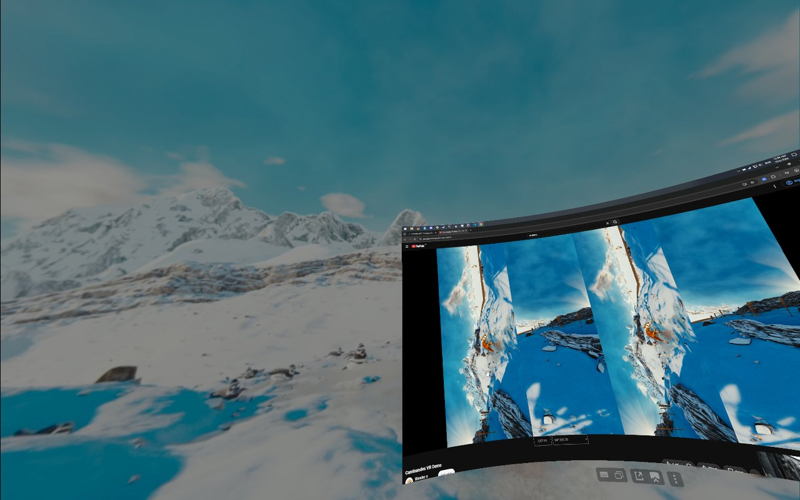
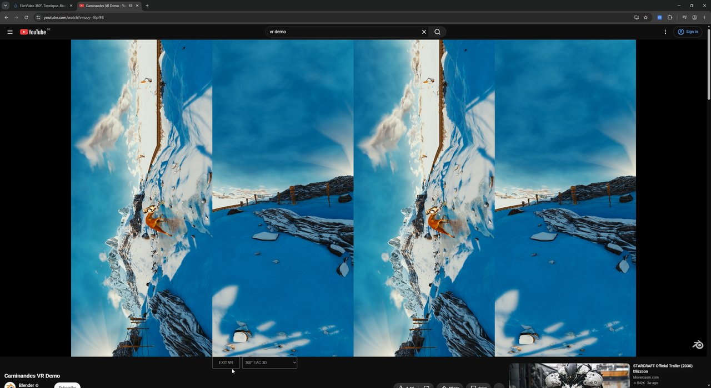
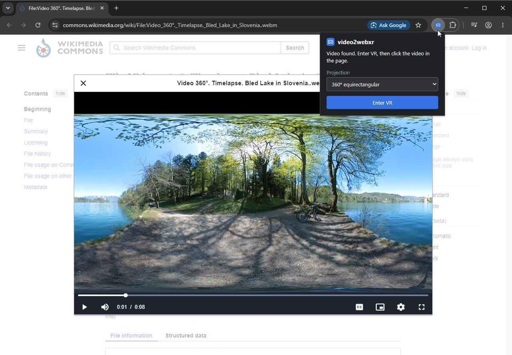
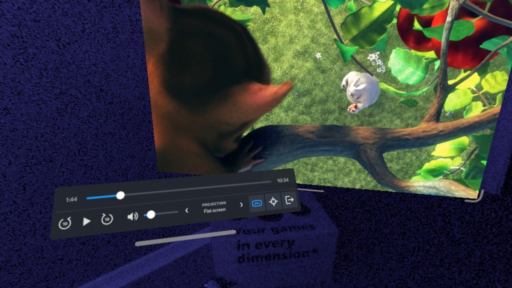

# video2webxr

A Chromium extension that plays web videos in your PC VR headset through WebXR, using https://threejs.org/

- **YouTube:** 360°, VR180, 3D and normal videos, via a cardboard icon in the player; the projection is detected automatically
- **Other sites:** any non-DRM video, via the extension's toolbar button
- **In VR:** a controls panel styled after the Steam Frame, and a flat screen you can move and resize with your controllers



### Install

**From a store**
- Chrome, Brave and other Chromium browsers: [Chrome Web Store](https://chromewebstore.google.com/detail/video2webxr/bacbclkmpiflnfeggheehlhhdmjjcfni)
- Microsoft Edge: [Edge Add-ons](https://microsoftedge.microsoft.com/addons/detail/video2webxr/pegmdbgaelolcgnfadanmahjnlallpon)

**Manually**
1. Download `video2webxr-<version>.zip` from the [latest release](https://github.com/phit/video2webxr/releases/latest) and unzip it to a folder
2. Open the extensions page in the browser and enable developer mode
3. Click "Load Unpacked" and choose the folder

**On the Steam Frame:** works in Chromium 157 or newer running on the Frame itself, from Steam Frame OS 0.5.7, with no flags or setup: install Chromium from Discover, then install the extension from the Chrome Web Store

### Usage
1. Turn VR on first (e.g. start SteamVR)
2. Start a new browser so that it detects the hardware

On the Steam Frame itself, skip these two steps: just open Chromium or Chrome.

**On YouTube**
1. Open a video: 360° or VR180 (e.g. from https://www.youtube.com/vr/), or a normal one for the flat screen
2. Click on the white cardboard icon in the bottom right hand corner of the video
3. The dropdown next to the "Enter VR" button shows the detected projection. 3D is recognised from the picture itself, so it switches to the 3D option once the video shows something other than a dark frame. Change it if it looks wrong
4. Click on the "Enter VR" button below the video

   

The toolbar button works on YouTube too, as on other sites: click "Enter VR" in the popup, then click the video. The projection is still detected automatically unless you pick one in the popup.

**On other sites**
1. Start playing the video
2. Click the video2webxr button in the browser toolbar (pin it from the extensions menu)
3. Pick the projection in the popup (defaults to Flat screen; your choice is remembered) and click "Enter VR"
4. Click the video in the page to enter VR. Browsers only start VR from a click in the page itself, so this step can't be skipped
5. Use the controls in VR, or open the popup again to change the projection or click "Stop"

   

The page itself gets no extra controls, so video lightboxes and overlays keep working.

**In VR**

A controls panel floats below the video: play/pause, the seek bar, skip 10 seconds back or forward, mute and volume, the projection (‹ › to switch), distance for 180° videos, passthrough, Recenter and Exit VR.



| To | Do this |
|---|---|
| Use a control | Point the controller's laser at it and pull the trigger; hold the trigger to drag the seek or volume slider |
| Hide or show the panel | Press A/X or B/Y. Pulling the trigger away from the screen also shows it, and it comes back in front of you if it was out of view |
| Move the panel or the flat screen | Drag the bar below it with the trigger, or hold the grip anywhere on it. It stays upright and turns to face you |
| Move it closer or further away | While holding it, push the thumbstick forward or back |
| Resize the flat screen | Drag its bottom right corner, or push the thumbstick left or right while holding it |
| Play or pause | Click the flat screen |
| Skip 10 seconds back or forward | Double click the left or right third of the flat screen, like on YouTube's mobile app; each further click skips another 10 seconds |
| Sit further back from a 180° video | Step backwards: the video stays where it is, as if it were a dome about 6 m across, so close-ups feel less in your face. Or press DISTANCE on the panel to step through three levels without moving (remembered per site). Recenter makes your current spot the centre again |
| See the room around the screen | Press the passthrough button (the headset icon). It works where the browser supports AR with passthrough, e.g. Chromium or Chrome on the Steam Frame, and only shows there |
| Put everything back in front of you | Recenter on the panel. On 360° and 180° videos it also turns the front of the video to where you look |

### Videos to try

| Video | Where | Projection |
|---|---|---|
| [Caminandes VR demo](https://www.youtube.com/watch?v=uvy--ElpfF8) | YouTube | 360° EAC 3D |
| [Tomorrowland 360°](https://www.youtube.com/watch?v=y0k8Akk1yN0) | YouTube | 360° EAC |
| [Elton John VR180](https://www.youtube.com/watch?v=9r6NI9m_IxM) | YouTube | 180° |
| [Bled Lake 360° timelapse](https://commons.wikimedia.org/wiki/File:Video_360%C2%B0._Timelapse._Bled_Lake_in_Slovenia..webm) | Wikimedia Commons, via the toolbar button | 360° equirectangular |

### Projections

| Projection | Use it for |
|---|---|
| 360° EAC | 360° videos on YouTube - this is how YouTube serves them on desktop |
| 360° EAC 3D | 3D 360° videos served as stereo EAC |
| 360° cubemap | videos in a plain 3x2 cubemap layout |
| 360° equirectangular | 360° videos served as a single equirectangular image (2:1) |
| 360° 3D top/bottom, side by side | 3D equirectangular 360° videos |
| 180° | VR180 videos on YouTube, and other mono 180° videos |
| 180° 3D side by side | 3D 180° videos with both eyes side by side, the most common VR video format |
| Flat screen (other sites' default) | normal videos, shown on a virtual screen in front of you |
| Flat screen 3D side by side, top/bottom | 3D movies and clips with both eyes side by side or above each other, on the same virtual screen. Works for both half size (a normal 16:9 frame) and full size (32:9 or 16:18); on YouTube it's picked automatically |
| Flat screen 3D (AI) | normal videos turned 3D: an AI model estimates the depth of every frame and the screen takes its shape. Needs a GPU with WebGPU, so PC VR only for now; not on the Steam Frame yet, while Chrome there is still waiting on updates from Valve. The first time you pick it, the extension downloads the 50 MB model from Hugging Face once, for every site; nothing is sent there but the download request |

You can switch the projection while in VR, from the panel. If the image looks jumbled into squares, try a 360° EAC option; if it looks stretched or doubled, try the others.

### Limitations
- DRM-protected videos (Netflix, Prime Video, Disney+ etc.) can't be shown: the browser won't hand protected frames to WebGL
- Videos served from another domain without CORS headers can't be read by WebGL either; the extension retries with CORS turned on and tells you if that doesn't work
- On other sites the toolbar button can only reach videos in the page itself and in same-site frames

### Troubleshooting
If "Enter VR" says "VR NOT SUPPORTED", the browser hasn't found your headset: make sure SteamVR is running and the headset is connected, then restart the browser.

If entering VR fails with "The VR runtime couldn't start a session" (shown below the Enter VR button on YouTube, and in the popup on other sites), something else is holding the headset. Only one app can be in VR at a time:
- Another browser, window or app is in VR, or was and didn't let go. Exit VR there. If that doesn't help, close the browser completely, every window, and open it again; if it still fails, restart SteamVR
- On the Steam Frame, start the browser from the app menu, not from your Steam library as a non-Steam game: Steam then counts the browser itself as the running VR app and refuses its WebXR session

If clicking the video on other sites doesn't enter VR, the popup shows why the last attempt failed.

If you don't see the white cardboard icon in the bottom right hand corner of a YouTube video then the extension is not installed or disabled

### Development
Sources are in `src/`:
- `youtube.js`: YouTube integration (the cardboard icon, projection detection)
- `youtube-page.js`: runs in YouTube's own page context to read the player's data
- `stereo.js`: tells 3D frames from mono ones
- `generic.js`, `popup.*`: the toolbar button and its popup for other sites (on YouTube, the popup drives `youtube.js`)
- `click-to-enter.js`: "click the video to enter VR", shared by both
- `vr-player.js`: the shared WebXR player and projections
- `depth.js`, `model.js`, `background.js`: depth for "Flat screen 3D (AI)"; the service worker downloads the model
- `vr-controls.js`: the in-VR panel, lasers, moving and resizing
- `projections.js`: the projection names, shared by the player and the popup

```
npm install
npm run build   # builds the extension into dist/
npm run watch   # unminified with source maps, rebuilt on change
```
Load `dist/` unpacked in the browser. `npm run check` lints and checks formatting with [Biome](https://biomejs.dev/), and `npm run fix` applies fixes; CI fails on either.

Commit messages follow [Conventional Commits](https://www.conventionalcommits.org): `feat:`, `fix:`, `perf:`, `refactor:`, `docs:`, `build:`, `ci:`, `style:`, `chore:`, `test:`, optionally with a scope (`feat(youtube): ...`). Release notes are generated from them with [git-cliff](https://git-cliff.org); `npm run changelog` previews the notes for unreleased commits.

### Releasing
Bump `version` in `manifest.json` and `package.json`, commit (`chore: release 2.1.0`), then push a matching tag: `git tag v2.1.0 && git push origin v2.1.0`. GitHub Actions builds the zip and publishes the release with the generated notes.

### Credits
- Based on [EnableYoutubePCVR](https://github.com/feedthedogs/EnableYoutubePCVR) by feedthedogs (ISC)
- Cardboard icon from [Tabler Icons](https://tabler.io/icons) (MIT)
- Rendering by [three.js](https://threejs.org/) (MIT)
- Depth for "Flat screen 3D (AI)" by [Depth Anything V2 Small](https://huggingface.co/depth-anything/Depth-Anything-V2-Small) (Apache 2.0), in the [ONNX conversion by onnx-community](https://huggingface.co/onnx-community/depth-anything-v2-small) (downloaded from Hugging Face on first use, not bundled), run with [ONNX Runtime Web](https://onnxruntime.ai/) (MIT)
